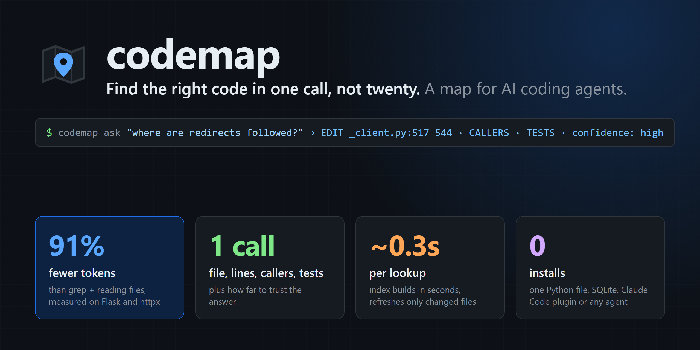
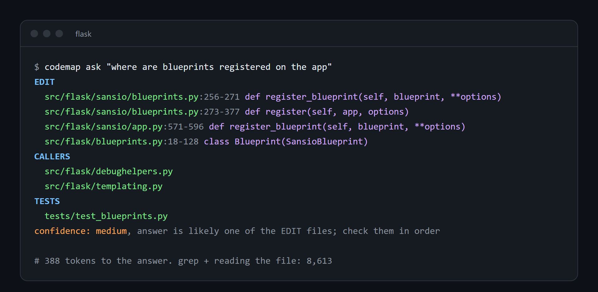
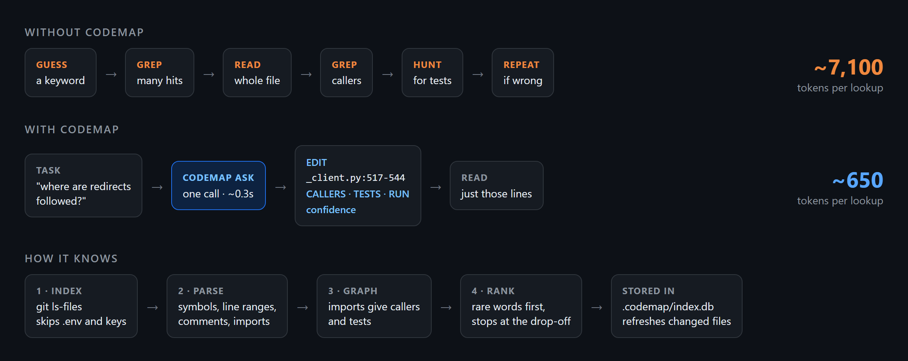
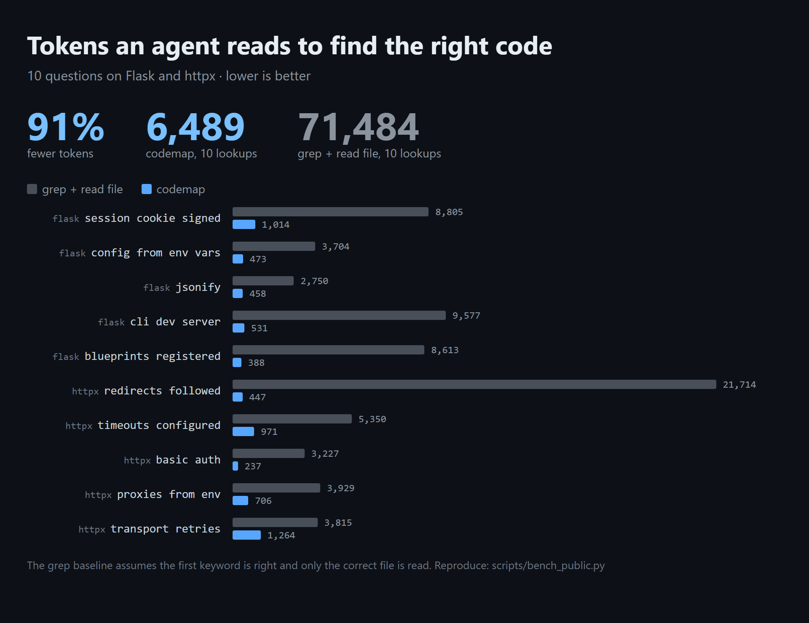
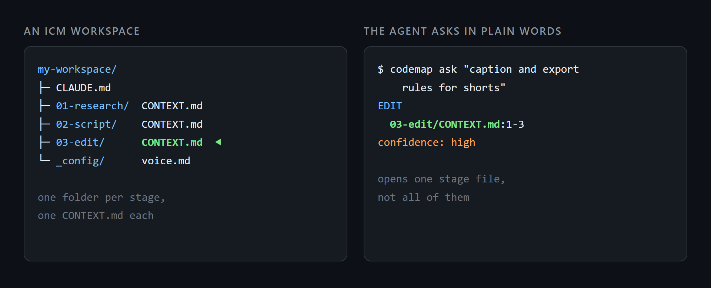

<h1 align="center"></h1>

<p align="center">A code map for AI coding agents. One call gives the file to edit with line ranges, who calls it, which tests cover it, and how far to trust the answer.</p>

<p align="center">


</p>



## Install

**Claude Code plugin** (recommended). Run this inside Claude Code:

```
/plugin install codemap --marketplace QDinvest/Code-Map-QD
```

On Claude Code older than 2.1.275, use two steps instead:

```
/plugin marketplace add QDinvest/Code-Map-QD
/plugin install codemap@codemap
```

Restart Claude Code. Every session now starts with a one-line note telling the agent to call codemap before grepping, and subagents get a `codemap` skill.

**Any other agent** (Codex, Cursor, Aider, your own scripts):

```bash
git clone https://github.com/QDinvest/Code-Map-QD codemap
cd your-project
python /path/to/codemap/scripts/codemap.py init --write
```

`init --write` adds 4 lines to your project's `CLAUDE.md` telling agents how to call codemap. Copy them into `AGENTS.md` or your agent's rules file if it reads a different one.

**Needs:** Python 3 (tested on 3.11) and a git repo. Nothing to `pip install`.

## How to use it

You don't have to do anything: the agent calls it. To try it yourself, run from inside any git repo:

```bash
python /path/to/codemap/scripts/codemap.py ask "where is the login rate limit"
```

| Command | What you get |
|---|---|
| `ask "<question or name>"` | `EDIT` files with line ranges, `CALLERS`, `TESTS`, `RUN` command, and a confidence line |
| `impact <file or symbol>` | What imports it (2 levels deep) and which tests to run if you change it |
| `file <path>` | Outline with line numbers. Cheaper than reading a big file |

The last line always tells the agent how much to trust the answer:

| Confidence | What the agent does |
|---|---|
| `high` | Reads only the first EDIT range |
| `medium` | Checks the EDIT files in order |
| `low` | Falls back to grep, using the words codemap suggests |

The first call in a repo builds the index in a few seconds. After that each call takes about 0.3 seconds and re-reads only files that changed. The index lives in `.codemap/` in your repo and is git-ignored automatically.

## Why it saves tokens



## Benchmark



10 "where is X" questions on [Flask](https://github.com/pallets/flask) and [httpx](https://github.com/encode/httpx):

| | Tokens (10 lookups) | Per lookup |
|---|---:|---:|
| grep + read the file | 71,484 | ~7,100 |
| **codemap** + read the line range | **6,489** | **~650** |

The grep numbers are generous to grep: they assume the agent's first keyword is right and it opens only the correct file. Run it yourself with [`scripts/bench_public.py`](scripts/bench_public.py).

## Works on ICM workspaces



[ICM (Interpretable Context Methodology)](https://arxiv.org/abs/2603.16021) runs agents from plain folders: one numbered folder per stage, with a `CONTEXT.md` in each. codemap indexes Markdown, YAML and TOML as well as code, so the agent asks in plain words and opens one stage file instead of all of them. The bigger the workspace, the more it saves.

## How it works

1. **Index** files from `git ls-files`. Skips `.env` files, keys and `secrets/` folders.
2. **Parse** symbols, line ranges, comments and imports. Python is parsed exactly; JS, TS and Solidity by pattern (marked `approx`).
3. **Graph** the imports, so codemap knows callers and tests.
4. **Rank** files by the rare words in your question. `auth token` also finds `verifyAuthToken`.

## Optional: synonym search

Out of the box, codemap matches the words in your question. If your question says "sign in" and the code says `authenticate`, it may miss. [`scripts/summarize.py`](scripts/summarize.py) fixes that by having a cheap Claude model write a short description of each file once.

This is off by default because it calls the Anthropic API, which costs money. To turn it on:

```bash
cd /path/to/codemap
python -m venv .venv
.venv/bin/pip install anthropic        # Windows: .venv\Scripts\pip install anthropic
export ANTHROPIC_API_KEY=your-key
```

From then on codemap describes new and changed files in the background. Set `CODEMAP_NO_SUMMARIES=1` to turn it off again.

## Limits

- Without the optional summaries, synonyms are missed. codemap says so with `confidence: low`.
- JS, TS and Solidity line ranges come from patterns and can be off on unusual formatting.
- Other languages are found by file path and text only.

## License

MIT. See [LICENSE](LICENSE).
